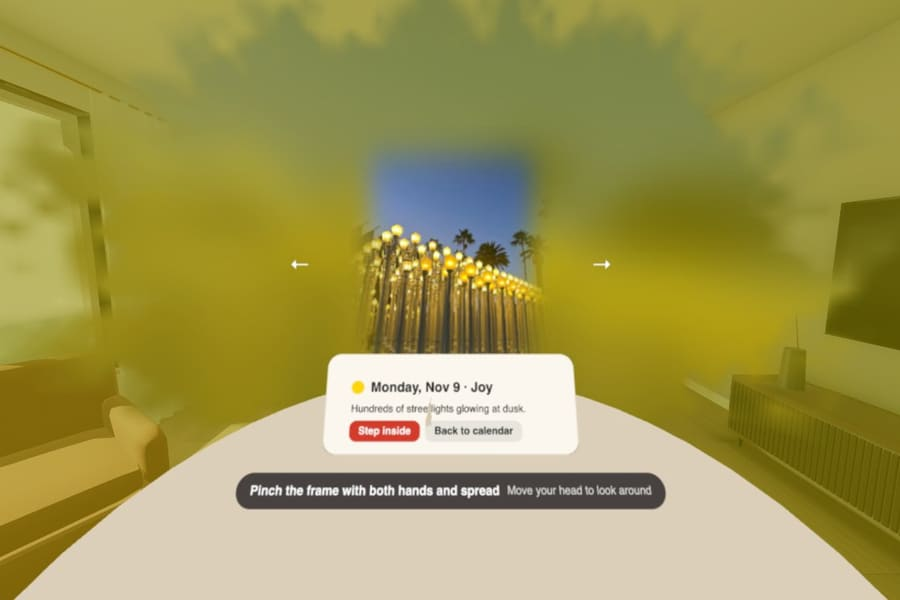
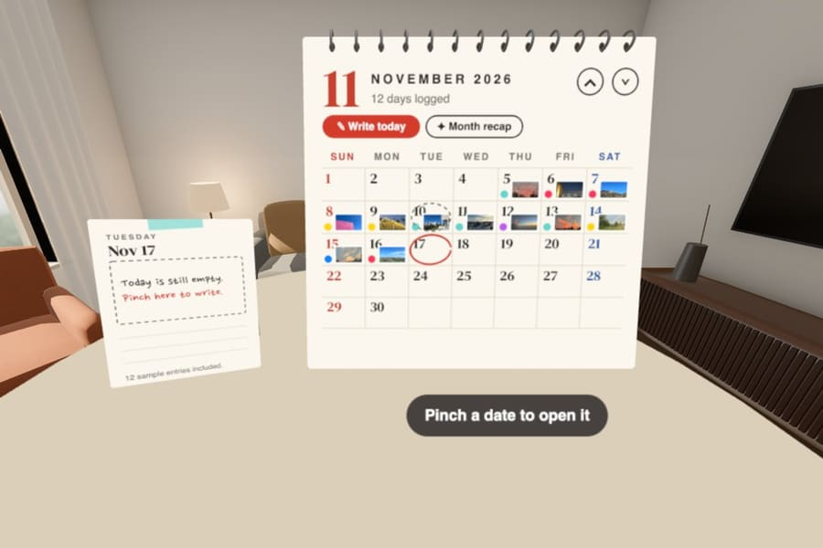
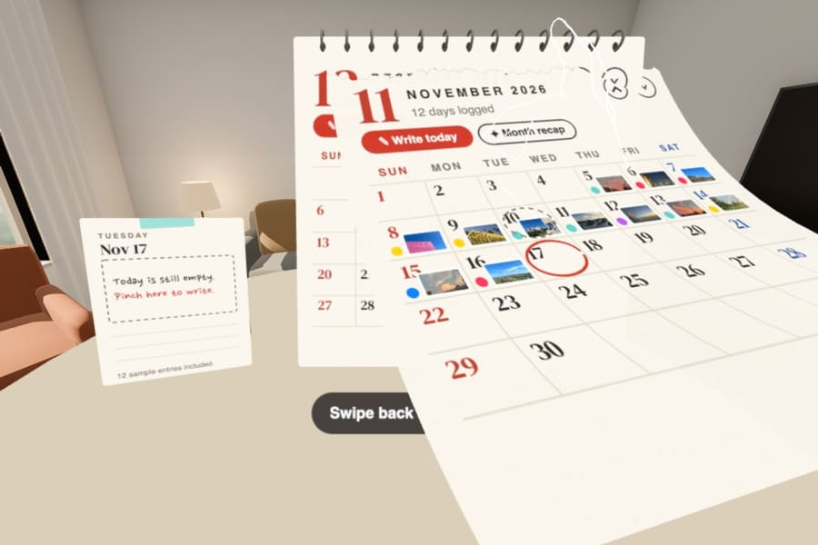
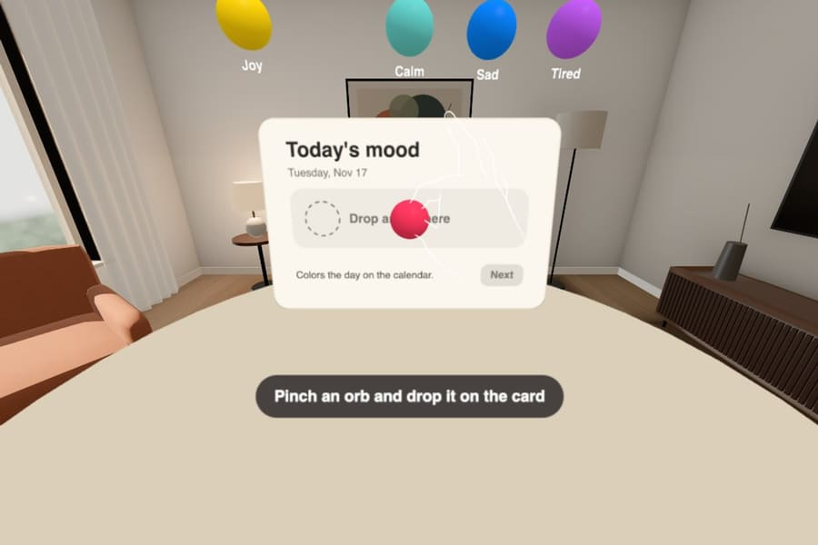
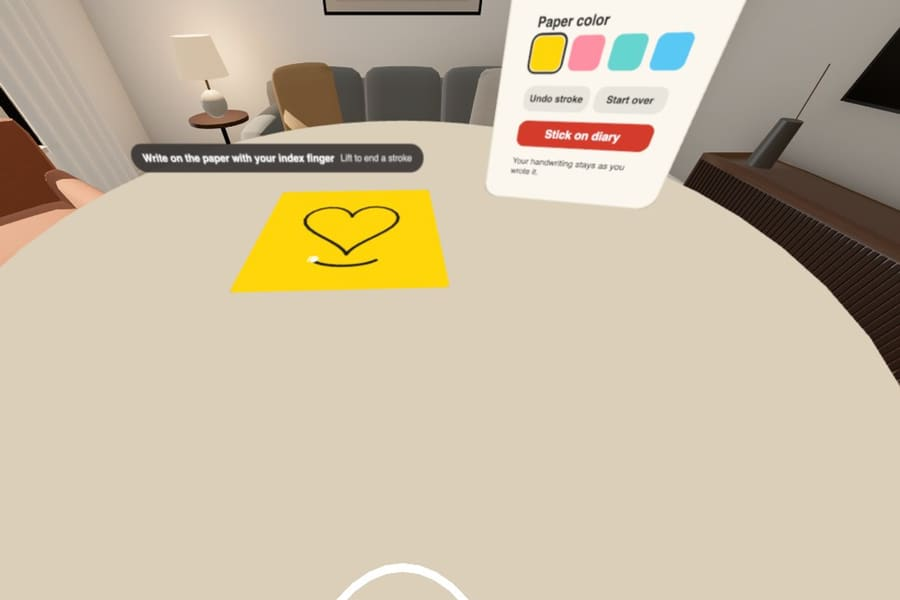
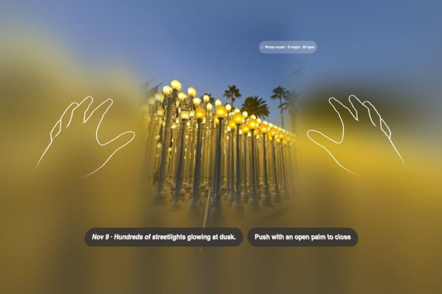
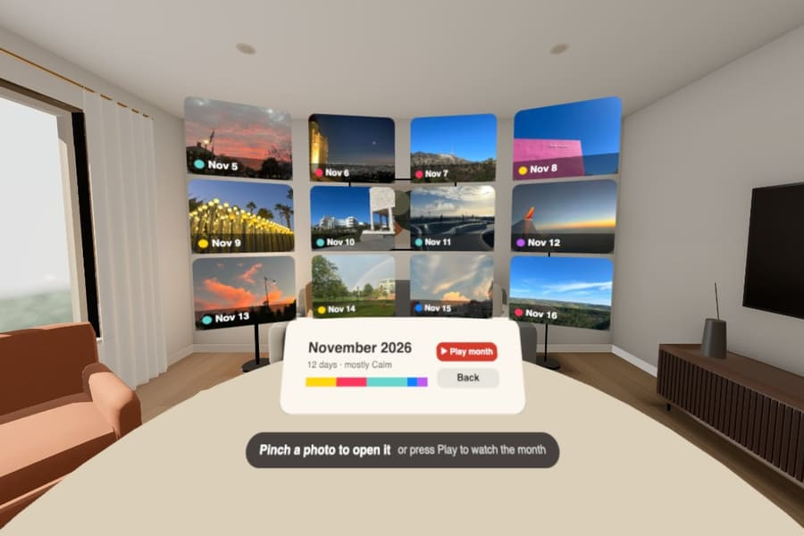

# VR Diary

**Your desk becomes your diary.** VR Diary is a mixed-reality journal for Meta Quest 3. A paper desk calendar and a diary card sit on your real desk in passthrough. Each day you drop a mood orb, leave one line and add a photo, which takes about 30 seconds. Past days open as 2.5D photos that bleed into your room like watercolour, and you can step inside them.

It runs in the browser, uses only your hands, and keeps everything on the headset: no account, no server, no upload.



**Try it:** open [vrdiary.vercel.app](https://vrdiary.vercel.app) in the Meta Quest Browser on a Quest 3, tap **Start with sample diary**, sit at a desk and enter VR.

Built for the Meta Horizon Start Developer Competition 2026.

## What you can do

| | |
| --- | --- |
|  |  |
| The calendar and diary card on your desk | Tear off the month by hand |
|  |  |
| Drop a mood orb on today's card | Write a Post-it with your fingertip |
|  |  |
| Spread a memory with both hands to step inside | Month recap: every day as a wall around you |

<sub>Screenshots from IWER, the IWSDK Quest 3 emulator, with emulated hands.</sub>

**Before VR (2D screen).** Pick today's photo from the headset gallery, or send one from a phone or computer with a 6-digit code. Depth Anything V2 works out the photo's depth right in the browser. You can also start with 12 sample diaries.

**On your desk.** The app finds your table with plane detection and places a spiral desk calendar and a diary card on it. Pinch a date to open that day. To change the month, pinch the top of the page and pull it down to tear it off, or swipe your palm up and down.

**Recording today.** Drop a mood orb (Joy, Excited, Calm, Sad or Tired) on the card, and its colour fills today's square. Leave a memo by typing one line on a poke keyboard, writing a Post-it with your fingertip, or holding the mic for a voice memo. Then drop the photo onto today's page, add stickers and save.

**Revisiting a memory.** The photo opens as a 2.5D frame that pops out using its depth, and its colours bleed over the walls like watercolour. Spread the frame with both hands to step inside the day. Each photo plays its own music, generated from its colours and depth. Push with an open palm to put the memory back.

**Month recap.** Every logged day lines up as a wall of photos around you. **Play month** plays them one after another as a reel.

## Hand interactions

Everything is done with bare hands; no controllers are needed.

| Gesture | What it does |
| --- | --- |
| Pinch (thumb and index closer than 2 cm, released past 4.5 cm) | Press buttons, open a date, pick up orbs, stickers, Post-its and the photo |
| Pinch and drag | Drop a mood orb on the card, the photo on today's page, stickers on the photo |
| Pinch the top of the page and pull about 10 cm | Tear off the month |
| Poke with the index fingertip | Type on the keyboard |
| Touch the desk with the index fingertip | Write on a Post-it |
| Pinch and hold the mic | Record a voice memo |
| Fast vertical palm swipe in front of the calendar | Turn the month (the hand must pause there first, so reaching for a button never counts) |
| Pinch with both hands and spread | Resize the calendar or a photo, and step inside a memory |
| Push an open palm toward a memory (about 0.6 m/s) | Close it |

## How it works

- **[Immersive Web SDK (IWSDK)](https://iwsdk.dev)** on Three.js, running as an immersive AR WebXR session with passthrough, hand tracking and plane detection.
- **On-device depth:** [Depth Anything V2 small](https://huggingface.co/onnx-community/depth-anything-v2-small) through [Transformers.js](https://huggingface.co/docs/transformers.js), on WebGPU (fp16) with a WebAssembly fallback. The model downloads once and is cached.
- **2.5D photos:** the depth map displaces a subdivided mesh, with soft faded edges.
- **Watercolour bleed:** a custom shader on a sphere around you reveals the photo's world from the frame outward. Its noise is read from a small texture so it stays smooth at the Quest GPU's lower float precision.
- **Paper UI:** the calendar, cards and keyboard are canvas textures drawn at 2400 pixels per metre, so text stays sharp up close.
- **Generated music:** the Web Audio API turns each photo's colour, warmth, saturation, detail and depth into a key, tempo and melody. There are no audio files.
- **Private by design:** entries, photos, depth maps and voice memos live in IndexedDB on the headset. Photos from a phone travel directly over WebRTC (PeerJS), which uses a public server only to pair the two devices.

## Run it locally

Requires Node.js 20.19+, 22.12+ or 24+.

```sh
npm install
npm run dev
```

The dev server is managed by the IWSDK CLI. It opens a browser with IWER, the IWSDK Quest 3 emulator, so you can try the app without a headset. `iwsdk.config.json` is the project config. To test on a Quest, open a URL from `npx @iwsdk/cli dev status` on the same Wi-Fi and accept the local certificate warning.

Add `?reset` to the URL to clear the diary and start over.

## Checks

```sh
npm run typecheck     # TypeScript
npm run swipe-check   # month-swipe gesture: real swipes count, reaches and drifts don't
npm run build         # production build into dist/
```

## Code

| File | What |
| --- | --- |
| `index.html` | 2D screen before VR: photo pick, phone transfer, depth preview |
| `src/index.ts` | World setup, photo to depth pipeline, phone-to-headset transfer |
| `src/diary.ts` | Desk, calendar, recording, memories, recap and all hand input |
| `src/panel.ts` | Canvas-drawn panels with pinchable buttons |
| `src/swipe.ts` | Month-swipe gesture detection |
| `src/depth.ts` | In-browser depth estimation |
| `src/photo3d.ts` | Depth-displaced 2.5D photo mesh |
| `src/music.ts` | Music generated from a photo |
| `src/audio.ts` | Sound effects |
| `src/db.ts` | IndexedDB entries |
| `src/samples.ts` | The 12 sample diaries |
| `public/samples/` | Sample photos and their precomputed depth maps |
| `scripts/sample-depth.mjs` | Precomputes depth maps for the sample photos (`npm run sample-depth`) |
| `scripts/swipe-check.ts` | Frame-by-frame check of the swipe gesture |
